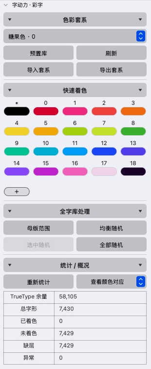
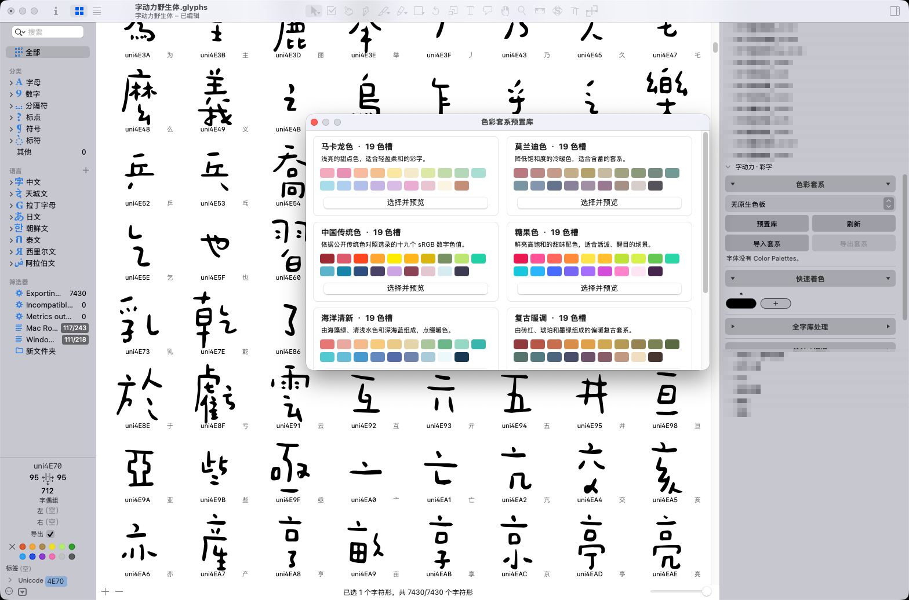
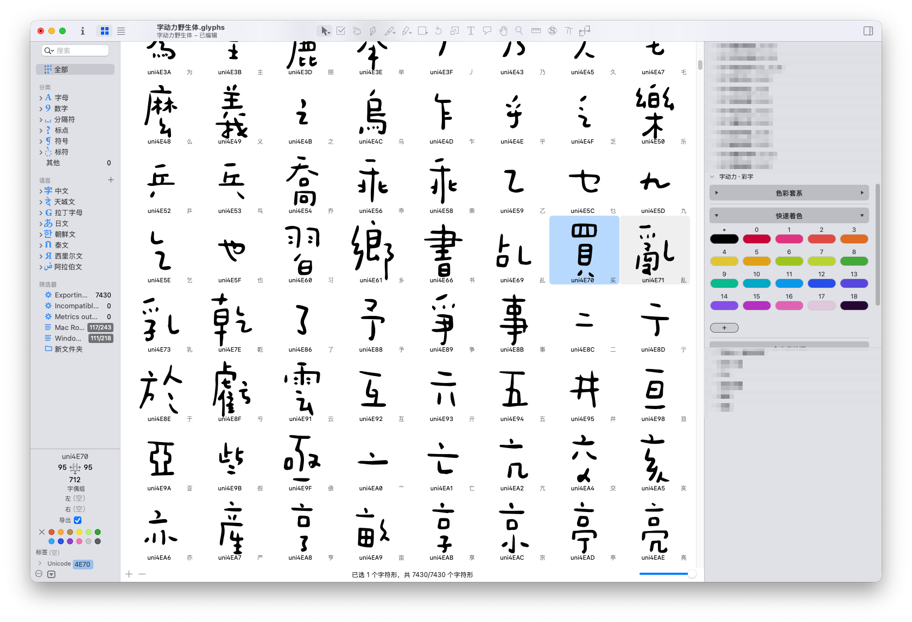
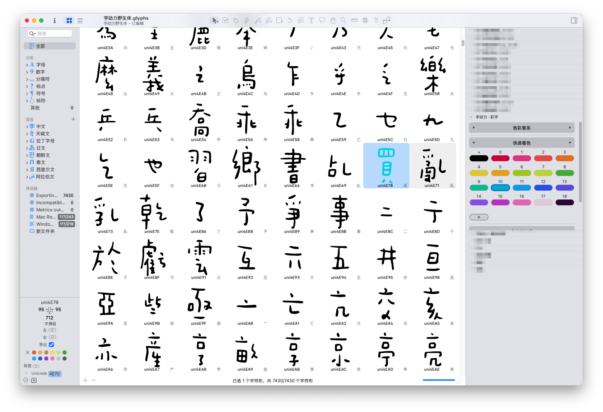
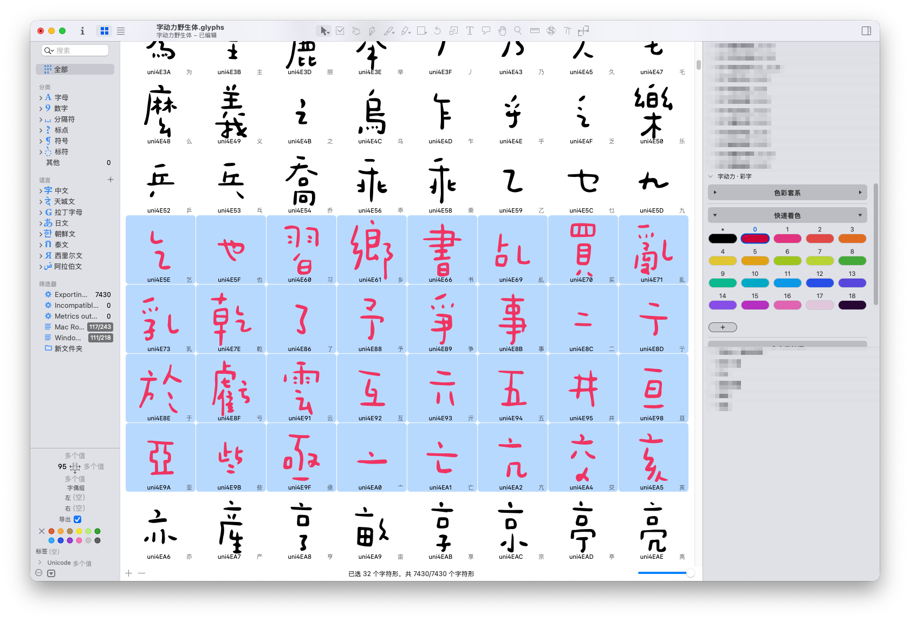
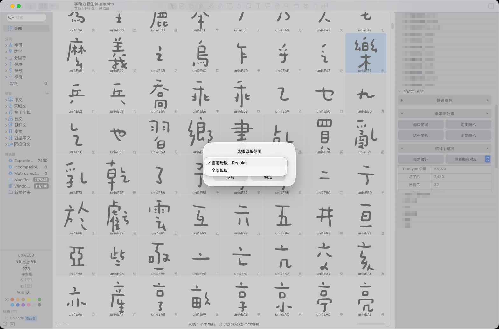
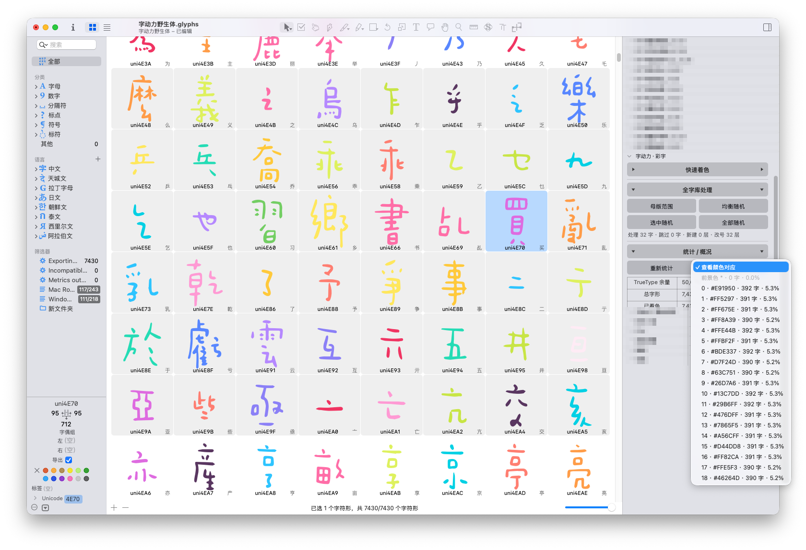

# 字动力·彩字 1.0.0

**让彩色字体设计变得简单。**

一款为 Glyphs 3 打造的彩色字体设计插件，支持单字着色、批量配色、随机配色及色板管理，让彩色字体制作更加方便。

## 01 插件界面总览

**一个面板，完成彩色字体的常用操作。** 集中色彩套系、快速着色、全字库处理和统计概况，常用功能一目了然。

## 02 预置色彩套系库

**多种配色方案，随时选用。** 内置多套预置色彩方案，支持预览和加载。同时支持 ASE、GPL 两种色板格式的导入与导出。

配套软件：

- ASE：Adobe Illustrator、Photoshop、InDesign。
- GPL：GIMP 等支持 GPL 色板的软件。

## 03 色彩套系编辑

**色块自由管理，配色更加灵活。** 加载色彩套系后，可直接查看所有色块。支持右键编辑颜色，以及增加、删除和调整色块顺序。

## 04 单字快速着色

**选中字形，点击色块，即可换色。** 选中需要着色的字格，再点击右侧对应色块，快速更换颜色。

## 05 多字批量着色

**多个字形，一次完成着色。** 选中多个字格，再点击目标色块，即可批量应用颜色，减少重复操作。

## 06 母版范围处理

**当前母版或全部母版，按需处理。** 支持选择当前母版或全部母版进行批量着色，方便处理多母版字体。

## 07 统计与概况

**颜色分布，一目了然。** 查看各个颜色对应的字形数量及占比，同时了解字体总字形数、已着色、未着色、缺失图层、异常情况和 TrueType 容量余量。

## 08 让彩色字体制作更简单

从色彩管理到单字着色，从批量配色到字体统计，常用功能集中在一个插件中。

字动力·彩字，让字体设计拥有更多色彩，也让日常制作更加轻松。

## 安装

1. 下载并解压 `字动力·彩字-1.0.0.zip`。
2. 将解压后的 `字动力·彩字-1.0.0.glyphsPalette` 放入 Glyphs 3 的 Plugins 目录：

   `~/Library/Application Support/Glyphs 3/Plugins/`

3. 重新打开 Glyphs。
4. 在插件面板中找到「字动力·彩字」。

已验证：Apple Silicon Mac、Glyphs 3.5（3532）。请勿同时安装两份彩字插件。

当前安装包为 ad hoc 签名，未完成 Developer ID 签名或 Apple 公证。
